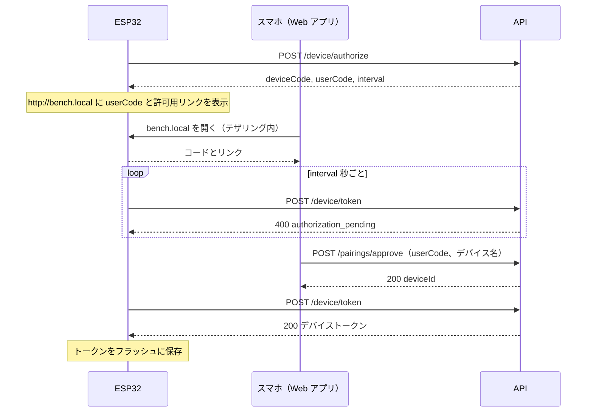

# ベンチプレス静止感知アプリ API仕様書

Nov 15, 2026 · @Kato Hayate

## 1. 共通仕様

API はすべて `/api/v1` 以下に置き、「誰が呼ぶか」で 3 種類の認証を使い分ける。この文書は設計としての仕様で、実装では @hono/zod-openapi から OpenAPI を自動生成してこれと突き合わせる。

### 認証の種類

| 記号 | 誰が使うか | 送り方 | 説明 |
| --- | --- | --- | --- |
| user | Web アプリ | `Authorization: Bearer <アクセストークン（JWT）>` | 有効期限 15 分。切れたらリフレッシュで取り直す |
| device | ESP32 | `Authorization: Bearer <デバイストークン>` | 使えるのは `/api/v1/device/...` の記録登録と設定取得だけ（FR-A05） |
| none | 誰でも | なし | ログイン開始、ペアリング開始、ヘルスチェックなど |

### 形式のルール

| 項目 | ルール |
| --- | --- |
| ベース URL | `https://<Worker のドメイン>/api/v1`。Web アプリと同じオリジンなので CORS は不要 |
| 通信 | HTTPS のみ |
| データ形式 | JSON（`application/json`、UTF-8）。生データだけ `application/octet-stream` |
| キーの書き方 | camelCase（例：`weightKg`）。DB の列名（snake\_case）との変換は API が行う |
| ID | UUID の文字列 |
| 日時 | ISO 8601、UTC（例：`2026-11-15T10:00:00.000Z`）。練習日だけは日本時間の日付（例：`2026-11-15`） |
| 数値の単位 | 列名の末尾で示す（`Ms` ミリ秒、`Kg` キログラム、`Mps` メートル毎秒、`Hz`） |
| エラー | RFC 9457 の `application/problem+json`。例外はペアリングのトークン取得（RFC 8628 の形式に従う） |
| ページング | カーソル方式。`?limit=20&cursor=<前回の nextCursor>`、レスポンスに `nextCursor`（最後なら null） |
| 冪等性 | セット登録はデバイスが作る `clientSetId` で重複を防ぐ。生データは PUT なので何度送っても同じ結果 |

### エラーの形

```json
{
  "type": "https://bench-pause.example/errors/validation-failed",
  "title": "入力が不正です",
  "status": 422,
  "detail": "rpe は 1〜10 の範囲で指定してください",
  "code": "validation_failed",
  "errors": [{ "path": "rpe", "message": "Number must be less than or equal to 10" }]
}
```

`code` はプログラムで分岐するための独自の識別子（7 章）。`errors` は入力チェックの失敗時だけ付く。

## 2. エンドポイント一覧

全 25 本。パスは `/api/v1` を省略している。

| 分類 | メソッド | パス | 認証 | 内容 | 要件 |
| --- | --- | --- | --- | --- | --- |
| 共通 | GET | `/health` | none | 死活確認 | — |
| ユーザー認証 | GET | `/auth/google/start` | none | Google のログイン画面へリダイレクト | FR-A01 |
| ユーザー認証 | GET | `/auth/google/callback` | none | Google から戻ってきたところ。ログインを完了する | FR-A01 |
| ユーザー認証 | POST | `/auth/refresh` | Cookie | アクセストークンの再発行とリフレッシュトークンの交換 | FR-A01, A02 |
| ユーザー認証 | POST | `/auth/logout` | Cookie | ログアウト（リフレッシュトークンを失効） | FR-A02 |
| ユーザー認証 | GET | `/me` | user | 自分の情報 | — |
| ペアリング | POST | `/device/authorize` | none | ESP32 がペアリングを開始し、コードを受け取る | FR-A03 |
| ペアリング | POST | `/device/token` | none | ESP32 が許可されたか確認し、デバイストークンを受け取る | FR-A03 |
| ペアリング | POST | `/pairings/approve` | user | Web アプリでコードを入力して許可する | FR-A03 |
| ペアリング | POST | `/pairings/deny` | user | 許可しない | FR-A03 |
| デバイス向け | GET | `/device/settings` | device | 最新の設定を取得 | FR-D10, S07 |
| デバイス向け | POST | `/device/sets` | device | セットとレップを登録（冪等） | FR-S02, S04 |
| デバイス向け | PUT | `/device/sets/{clientSetId}/raw` | device | 生データを登録 | FR-D12 |
| 練習日 | GET | `/sessions` | user | 練習日の一覧 | FR-V01 |
| 練習日 | GET | `/sessions/{sessionId}` | user | 練習日のセットとレップ（速度分布用） | FR-V01, V03 |
| セット | GET | `/sets` | user | 新しく届いたセットを取得（練習中の自動更新用） | FR-V07 |
| セット | GET | `/sets/{setId}` | user | セットの詳細（速度カーブつき） | FR-V02, V08 |
| セット | PATCH | `/sets/{setId}` | user | 重量・RPE・メモの入力・編集 | FR-V04 |
| セット | DELETE | `/sets/{setId}` | user | セットの削除 | FR-V05 |
| セット | GET | `/sets/{setId}/raw` | user | 生データのダウンロード | FR-D12 |
| デバイス管理 | GET | `/devices` | user | デバイス一覧（最終通信日時つき） | FR-A04, V09 |
| デバイス管理 | PATCH | `/devices/{deviceId}` | user | デバイス名の変更 | — |
| デバイス管理 | POST | `/devices/{deviceId}/revoke` | user | デバイストークンを失効（盗難・紛失時） | FR-A04 |
| 設定 | GET | `/devices/{deviceId}/settings` | user | 設定の取得 | FR-V06 |
| 設定 | PUT | `/devices/{deviceId}/settings` | user | 設定の変更 | FR-V06 |

**パスの使い分け**：`/device/...`（単数形）は ESP32 が「自分自身」について呼ぶ API、`/devices/...`（複数形）はユーザーが「自分の持っているデバイス」を管理する API。デバイストークンでは `/device/...` の一部しか呼べないようにし、権限の境界をパスでも分ける。

## 3. ユーザー認証

Google で本人確認したあと、API が自前のトークンを 2 つ発行する。リフレッシュトークンは Cookie、アクセストークンは JSON で返し、Web アプリはアクセストークンをメモリにだけ持つ。

### Cookie の仕様

| Cookie | 中身 | 属性 | 寿命 |
| --- | --- | --- | --- |
| `rt` | リフレッシュトークン | HttpOnly、Secure、SameSite=Strict、Path=/api/v1/auth | 30 日 |
| `oauth_state`、`oauth_verifier` | Google ログイン中の state と PKCE の合言葉 | HttpOnly、Secure、SameSite=Lax、Path=/api/v1/auth/google | 10 分。ログインが終わったら削除 |

`rt` の Path を `/api/v1/auth` に絞るのは、他の API には送られないようにして漏れる範囲を小さくするため。`oauth_*` だけ Lax なのは、Google から戻ってくるとき（別サイトからの遷移）にも Cookie を送ってもらう必要があるため。

### GET /auth/google/start

state と PKCE の合言葉を作って Cookie に入れ、Google のログイン画面へ `302` でリダイレクトする。スコープは `openid email profile`。

### GET /auth/google/callback?code=...&state=...

1. `state` が Cookie と一致するか確かめる（一致しなければ CSRF とみなして中止）。
2. Arctic で認可コードと PKCE の合言葉を Google に渡し、ID トークンを受け取る。
3. ID トークンの `sub` で oauth\_accounts を探し、なければユーザーを作る。
4. リフレッシュトークンを発行して `rt` Cookie に入れ、Web アプリのトップ（`/`）へ `302`。

失敗したときは `/login?error=<code>` へ `302`。

### POST /auth/refresh

Web アプリは起動時と、API が `401 token_expired` を返したときに呼ぶ。リクエストボディはなし（`rt` Cookie だけを使う）。

```json
// 200 OK（新しい rt Cookie も Set-Cookie で返す）
{
  "accessToken": "eyJhbGciOiJFUzI1NiIsImtpZCI6IjIwMjYtMTEifQ...",
  "expiresIn": 900
}
```

| 状況 | 結果 |
| --- | --- |
| 未使用で有効な `rt` | 古い `rt` を使用済みにし、同じ family\_id で新しい `rt` を発行。`200` |
| **使用済みの `rt` が来た** | **盗難とみなし、同じ family\_id のトークンをすべて失効**。`401 refresh_token_reused` |
| 期限切れ・失効済み・存在しない | `401 refresh_token_invalid`。Web アプリはログイン画面へ |

**同時に 2 回呼ばれたとき**：タブを 2 つ開いていると、同じ `rt` でほぼ同時に呼ばれ、後の方が盗難と誤判定されうる。対策として、使用済みになってから 10 秒以内の再利用は**アクセストークンだけを返し、Set-Cookie は付けない**。失効もしない（猶予時間）。DB にはハッシュしかないので直前に発行した `rt` の平文は返せないが、Cookie はタブ間で共有されるため、先に返った応答の新しい `rt` がそのまま使われる（2026-11-17 決定）。

### アクセストークン（JWT）の中身

```json
// ヘッダー
{ "alg": "ES256", "typ": "JWT", "kid": "2026-11" }
// ペイロード
{
  "iss": "https://<Worker のドメイン>",
  "aud": "bench-pause-api",
  "sub": "<users.id>",
  "iat": 1794737000,
  "exp": 1794737900
}
```

入れるのはユーザー ID と有効期限など最低限だけ（JWT の中身は誰でも読めるため）。`kid` は署名に使った鍵の名前で、鍵を入れ替えても古いトークンを正しく検証できるようにする。

### POST /auth/logout

`rt` の family\_id に属するトークンをすべて失効し、`rt` Cookie を削除する。`204 No Content`。

### GET /me

```json
// 200 OK
{ "id": "8b1e...", "email": "kato@example.com", "displayName": "Kato" }
```

## 4. ペアリング（RFC 8628）

ESP32 が短いコードをもらって表示し、ログイン済みの Web アプリでそのコードを入力して許可すると、ESP32 がデバイストークンを受け取れる。ESP32 は許可されるまで、決まった間隔で「許可された？」と問い合わせ続ける（ポーリング）。



**実際の手順（部室で iPhone 1 台で行う）**

1. 設定モードの ESP32 が出す Wi-Fi（AP）に iPhone をつなぎ、設定ページでテザリングの SSID とパスワードを登録する。
2. iPhone のテザリングをオンにする。ESP32 がつながり、`POST /device/authorize` でコードを受け取る。
3. iPhone のブラウザで `http://bench.local` を開く（ESP32 が mDNS で名乗る名前）。コードと「Web アプリで許可する」ボタンが表示される。
4. ボタン（`verificationUriComplete`）を押すと、コード入力済みの Web アプリが開くので「許可」を押す。テザリング中も iPhone 自身は 5G でインターネットにつながっている。
5. ESP32 は次の問い合わせでデバイストークンを受け取り、完了。

スマホは iPhone を前提とする（Android は機種によって `.local` の名前を引けない）。コードの有効期限は 10 分。

### POST /device/authorize（認証：none）

```json
// リクエスト
{ "firmwareVersion": "0.1.0" }

// 200 OK
{
  "deviceCode": "kHq3...（43 文字のランダム文字列）",
  "userCode": "BCDF-GHJK",
  "verificationUri": "https://<Worker のドメイン>/devices/pair",
  "verificationUriComplete": "https://<Worker のドメイン>/devices/pair?code=BCDF-GHJK",
  "expiresIn": 600,
  "interval": 5
}
```

- `deviceCode` は ESP32 だけが知る合言葉で、DB にはハッシュだけ保存する。
- `userCode` は人が入力するコード。8 文字で、数字の 0 と英字の O のような紛らわしい文字と母音を使わない（RFC 8628 の推奨）。

### POST /device/token（認証：none）

```json
// リクエスト
{
  "grantType": "urn:ietf:params:oauth:grant-type:device_code",
  "deviceCode": "kHq3..."
}

// 200 OK（許可されたとき。トークンはこの 1 回だけ返す）
{
  "accessToken": "dvt_7Gk2...（ランダム文字列）",
  "tokenType": "Bearer",
  "deviceId": "3f0a..."
}

// 400（まだ許可されていないとき）
{ "error": "authorization_pending" }
```

| `error` | 意味 | ESP32 の動き |
| --- | --- | --- |
| `authorization_pending` | まだ許可されていない | interval 秒後にもう一度問い合わせる |
| `slow_down` | 問い合わせが速すぎる | interval を 5 秒延ばす |
| `access_denied` | 拒否された | ペアリングをやめる（電源を入れ直すまで新しいコードを出さない） |
| `expired_token` | コードの期限切れ（10 分）、または受け取り済み | 最初からやり直す |

**RFC との違い**：RFC 8628 はフォーム形式で受け取り、項目名は snake\_case。この API では ESP32 の実装を単純にするため JSON と camelCase に揃え、流れとエラー名だけを RFC に合わせる。

### POST /pairings/approve（認証：user）

```json
// リクエスト
{ "userCode": "BCDF-GHJK", "deviceName": "部室のベンチ" }

// 200 OK
{ "deviceId": "3f0a..." }
```

許可すると、devices と初期値の device\_settings を作る。デバイストークンは、次に ESP32 が `/device/token` を呼んだときに発行する。許可した時点から 10 分間は、ESP32 がトークンを受け取れる（期限ぎりぎりに許可しても受け取れるように。2026-11-17 決定）。コードがない・期限切れ・処理済みのときはエラー（7 章）。入力は大文字小文字とハイフンの有無を区別しない。

### POST /pairings/deny（認証：user）

リクエストは `{ "userCode": "BCDF-GHJK" }`。身に覚えのないコードを拒否する。`204 No Content`。

## 5. デバイス向け API

ESP32 がデバイストークンで呼ぶ API は 3 本だけ。どれかが呼ばれると、そのデバイスの `last_seen_at`（とトークンの `last_used_at`）を更新する。ただし設定は数秒おきに問い合わせるので、前回の更新から 1 分以内なら書き直さない（2026-11-17 決定。DB の書き込みを減らすため）。

### GET /device/settings

セット中でないときに数秒おきに呼ぶ。設定が変わっていなければ中身なしの `304` を返し、通信量と CPU を節約する。

```
GET /api/v1/device/settings
Authorization: Bearer dvt_7Gk2...
If-None-Match: "3"          ← 手元の設定の version
```

```json
// 200 OK（ETag: "4"）
{
  "version": 4,
  "mode": "auto_signal",
  "pause": { "mode": "random", "minMs": 500, "maxMs": 1500 },
  "stillThreshold": null
}
```

- 変わっていなければ `304 Not Modified`（ボディなし）。
- `pause` は固定なら `{ "mode": "fixed", "fixedMs": 1000 }`、回数記録モードなら `null`。
- `stillThreshold` が `null` ならファームの既定値を使う。範囲外（0 以下、または 0.15 m/s 以上）の値を受け取ったら、ファームは警告をログに出して既定値を使う（待ち時間などほかの設定は使う）。
- ESP32 は 5 秒おきに問い合わせ、セット中は止める。新しい設定はセットの合間に反映し、LittleFS に保存して次の起動でも使う（FR-D10）。
- 設定の行がないデバイスには、初期設定（自動合図・固定 1.0 秒・しきい値は既定値）の行を作って返す。

### POST /device/sets

セットが終わるたびに呼ぶ。再送キューからの再送も同じ API。

```json
// リクエスト
{
  "clientSetId": "c5d2e0f4-...",
  "settingsVersion": 4,
  "mode": "auto_signal",
  "pause": { "mode": "random", "minMs": 500, "maxMs": 1500 },
  "startedAt": "2026-11-15T09:30:12.400Z",
  "endedAt": "2026-11-15T09:30:41.900Z",
  "reps": [
    {
      "index": 1,
      "startOffsetMs": 1200,
      "eccentricMs": 950,
      "pauseTargetMs": 1130,
      "pauseActualMs": 1190,
      "reactionMs": 240,
      "isPremature": false,
      "concentricMs": 1050,
      "meanVelocityMps": 0.42,
      "peakVelocityMps": 0.71,
      "curveHz": 100,
      "velocityCurve": [0.0, 0.08, 0.21, 0.35, "...（約 100〜150 個）"]
    }
  ]
}
```

| 状況 | レスポンス |
| --- | --- |
| 初めて届いたセット | `201 Created` `{ "setId": "...", "sessionId": "...", "created": true }` |
| **同じ clientSetId がもう一度届いた** | **`200 OK` `{ "setId": "...", "sessionId": "...", "created": false }`。中身は更新しない** |
| 入力がおかしい | `422 validation_failed`。再送しても通らないので、ESP32 はこの記録をキューから外してログだけ残す |
| トークンが無効・失効している | `401 device_token_invalid` / `device_token_revoked`。ESP32 はトークンを消してペアリングし直す。前のペアリングのときの未送信の記録は、持ち主が変わりうるので新しいトークンでは送らずに捨てる（ペアリング前に取った記録は送る。2026-11-17 決定） |
| サーバの一時的な問題 | `5xx`。キューに残して、間隔を延ばしながら再送（指数バックオフ） |

ESP32 は `200` か `201` を受け取ったときだけ、その記録をフラッシュから消す（FR-S06）。

**入力チェックの主なルール**

- `mode` が `count_only` なら `pause`、`pauseTargetMs`、`reactionMs` は null。`auto_signal` なら `pause` は必須
- `startedAt` ≦ `endedAt`、`reps[].index` は 1 からの連番
- `velocityCurve` は 1 レップ 500 個まで、リクエスト全体は 64KB まで
- 重量・RPE・メモはデバイスからは送らない（Web アプリで入力する）

**時刻が合っていないとき（FR-S08）**：補正はファームで行い、API は何もしない。NTP で時刻を合わせる前に取った記録は、ファームが NTP 同期の後に「現在時刻 −（現在の uptime − 記録時の uptime）」で実時刻に直してから、普通の `startedAt` / `endedAt` として送る（要件定義書 4.3 のメモ）。

### PUT /device/sets/{clientSetId}/raw

生データをバイナリのまま送る。`POST /device/sets` が成功したあとに呼ぶ。

```
PUT /api/v1/device/sets/c5d2e0f4-.../raw
Authorization: Bearer dvt_7Gk2...
Content-Type: application/octet-stream
X-Sample-Rate-Hz: 100
X-Format-Version: 1

<バイナリ：1 サンプル 12 バイト × サンプル数>
```

- 形式版 1：1 サンプルごとに加速度 X・Y・Z、角速度 X・Y・Z を 16 ビット整数（リトルエンディアン）で並べる。単位とレンジはファームの ADR で決める
- 上限 256KB。API は中身を解析せずそのまま保存する（CPU 10ms 対策）
- 成功は `204 No Content`。同じセットに何度送っても上書きされるだけ（冪等）。セットがまだ登録されていなければ `404 set_not_found`

## 6. Web アプリ向け API

すべて user 認証。**他のユーザーのデータの ID を指定されたときは `403` ではなく `404` を返す**（「その ID が存在すること」自体を漏らさないため）。

### GET /sessions?limit=20&cursor=...

練習日の一覧を新しい順に返す。

```json
// 200 OK
{
  "items": [
    { "id": "a1...", "date": "2026-11-15", "setCount": 6, "repCount": 28, "bestMeanVelocityMps": 0.61 }
  ],
  "nextCursor": "eyJkIjoiMjAyNi0xMS0xMCJ9"
}
```

### GET /sessions/{sessionId}

その日のセットと、各レップの速度を返す。速度分布のグラフはこれを元に画面で作る。速度カーブは重いので含めない。

```json
// 200 OK
{
  "id": "a1...",
  "date": "2026-11-15",
  "sets": [
    {
      "id": "s1...",
      "startedAt": "2026-11-15T09:30:12.400Z",
      "mode": "auto_signal",
      "weightKg": 100.0,
      "rpe": 8.0,
      "note": null,
      "repCount": 5,
      "reps": [
        { "index": 1, "meanVelocityMps": 0.42, "peakVelocityMps": 0.71, "isPremature": false, "pauseActualMs": 1190, "reactionMs": 240 }
      ]
    }
  ]
}
```

### GET /sets?createdAfter=...

練習中に Web アプリが 3 秒おきに呼び、新しく届いたセットを取る（FR-V07）。スマホとサーバの時計のずれを避けるため、次回の `createdAfter` にはレスポンスの `serverTime` をそのまま使う。

```json
// 200 OK
{
  "items": [ { "id": "s7...", "sessionId": "a1...", "startedAt": "...", "mode": "auto_signal", "repCount": 5, "weightKg": null } ],
  "serverTime": "2026-11-15T09:31:05.000Z"
}
```

### GET /sets/{setId}

セットの詳細。`GET /sessions/{id}` の各セットの項目に加えて、使った設定（`pause`）、終了時刻、生データの有無（`hasRawData`）、各レップの全項目（速度カーブ `velocityCurve` を含む）を返す。

### PATCH /sets/{setId}

重量・RPE・メモを入力・編集する。送った項目だけ変わり、`null` を送ると空に戻る。

```json
// リクエスト
{ "weightKg": 100.0, "rpe": 8.5, "note": "2 レップ目で少し波打った" }
```

ルール：`weightKg` は 0〜500、0.5 刻み。`rpe` は 1〜10、0.5 刻み。`note` は 500 文字まで。成功は `200` で更新後のセットを返す。

### DELETE /sets/{setId}

セットとそのレップ・生データを削除する。`204 No Content`。練習日の行は残す（削除したセットの行が練習日を指したまま残るため）。有効なセットが 0 件になった練習日は、練習日の一覧に出さない。

注意：削除後に ESP32 が同じ clientSetId で再送すると、セットが復活してしまう。これを防ぐため、削除したセットの clientSetId を記録しておき、再送されても `200 created:false` を返して保存しない（8 章）。

### GET /sets/{setId}/raw

生データを `application/octet-stream` で返す。ヘッダーに `X-Sample-Rate-Hz` と `X-Format-Version`。なければ `404 raw_data_not_found`。

### GET /devices

```json
// 200 OK
{
  "items": [
    { "id": "3f0a...", "name": "部室のベンチ", "lastSeenAt": "2026-11-15T09:31:00Z", "active": true, "createdAt": "..." }
  ]
}
```

`active` は有効なデバイストークンがあるかどうか。

### PATCH /devices/{deviceId}

リクエストは `{ "name": "部室のベンチ 2" }`。`200` で更新後のデバイスを返す。

### POST /devices/{deviceId}/revoke

そのデバイスのトークンをすべて失効させる（盗難・紛失時）。以降 ESP32 は `401 device_token_revoked` を受け取る。記録は消えない。再び使うにはペアリングし直す。`204 No Content`。

### GET /devices/{deviceId}/settings と PUT /devices/{deviceId}/settings

GET は `GET /device/settings` と同じ形に `updatedAt` を足したもの。PUT は設定をまるごと置き換える。

```json
// PUT リクエスト（If-Match: "4" を付けると、その間に別の画面で変更されていたら 412 で止める）
{
  "mode": "auto_signal",
  "pause": { "mode": "fixed", "fixedMs": 1000 },
  "stillThreshold": null
}

// 200 OK
{ "version": 5, "mode": "auto_signal", "pause": { "mode": "fixed", "fixedMs": 1000 }, "stillThreshold": null, "updatedAt": "..." }
```

ルール：待ち時間は 200〜5000ms、ランダムは minMs ≦ maxMs。回数記録モードなら `pause` は `null`。`stillThreshold` は `null`（ファームの既定値）か、0 より大きく 0.15 m/s 未満（`packages/shared` の `STILL_THRESHOLD_MAX_MPS`。理由は ADR-0003）。更新のたびに `version` が 1 増え、ESP32 は次の問い合わせで新しい設定を受け取る。

## 7. エラーコード一覧

| HTTP | code | 意味 | 呼び出し側の対応 |
| --- | --- | --- | --- |
| 400 | `bad_request` | JSON が壊れているなど | 直さないと通らない |
| 401 | `token_missing` | 認証ヘッダーがない（user の API） | ログイン画面へ |
| 401 | `token_expired` | アクセストークンの期限切れ | `/auth/refresh` してからやり直す |
| 401 | `token_invalid` | 署名が不正など | ログイン画面へ |
| 401 | `refresh_token_invalid` | リフレッシュトークンが無効・期限切れ | ログイン画面へ |
| 401 | `refresh_token_reused` | 使用済みリフレッシュトークンの再利用（盗難の疑い） | ログイン画面へ。警告を表示 |
| 401 | `device_token_invalid` | デバイストークンが存在しない。認証ヘッダーがない・形が違うときもこれ（ESP32 の対応が同じなので分けない） | ペアリングをやり直す |
| 401 | `device_token_revoked` | デバイストークンが失効済み | 記録は残し、ペアリングを待つ |
| 403 | `forbidden` | デバイストークンで user 用の API を呼んだなど | 実装の誤り |
| 404 | `not_found` | 対象がない（他人のデータも含む） | — |
| 404 | `set_not_found` | 生データの送り先のセットが未登録 | 先に `POST /device/sets` を送る |
| 404 | `raw_data_not_found` | 生データがない | — |
| 404 | `user_code_not_found` | ペアリングのコードがない | 入力し直す |
| 409 | `pairing_already_handled` | そのコードは許可・拒否済み | — |
| 410 | `user_code_expired` | コードの期限切れ | ESP32 側でペアリングをやり直す |
| 412 | `precondition_failed` | If-Match の version が古い（別の画面で設定が変わった） | 読み直してから変更する |
| 413 | `payload_too_large` | JSON が 64KB、生データが 256KB を超えた | — |
| 422 | `validation_failed` | 入力ルール違反。`errors` に詳細 | 直さないと通らない |
| 429 | `rate_limited` | 短時間に呼びすぎ | `Retry-After` 秒待つ |
| 500 | `internal_error` | サーバの不具合 | 時間を置いて再試行 |
| 503 | `db_unavailable` | DB につながらない（Neon の起動待ちなど） | 時間を置いて再試行 |

ペアリングの `POST /device/token` だけは、この表ではなく 4 章の RFC 8628 のエラーを返す。

## 8. データ設計への反映と未決事項

API を設計した結果、データ設計に 2 つ足すものがある。

| 追加 | 内容 | 理由 |
| --- | --- | --- |
| device\_authorizations テーブル | device\_code\_hash（UNIQUE）、user\_code（UNIQUE）、status（pending / approved / denied / consumed）、expires\_at、last\_polled\_at、user\_id、device\_id、device\_name | ペアリングの途中状態を持つため。last\_polled\_at で `slow_down` を判定する |
| sets.deleted\_at 列 | 削除したセットは行を残して日時を入れ、レップと生データだけ消す。一覧では除外する | 削除後に同じ clientSetId が再送されても復活させないため |

- [x] 上の 2 つをデータ設計ドキュメントに反映済み
- [ ] 生データの形式版 1 の単位とレンジ（加速度 ±4g、角速度 ±500°/s など）をファーム実装時に決める
- [ ] レート制限の具体的な値を決める（特に `/auth/*` と `/pairings/approve`）
