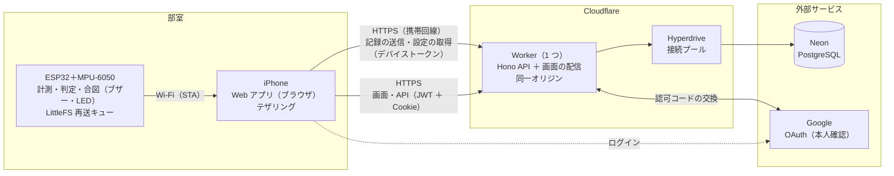
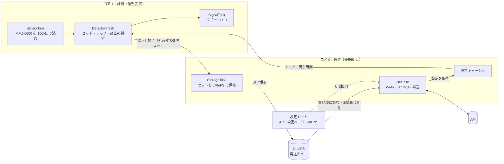
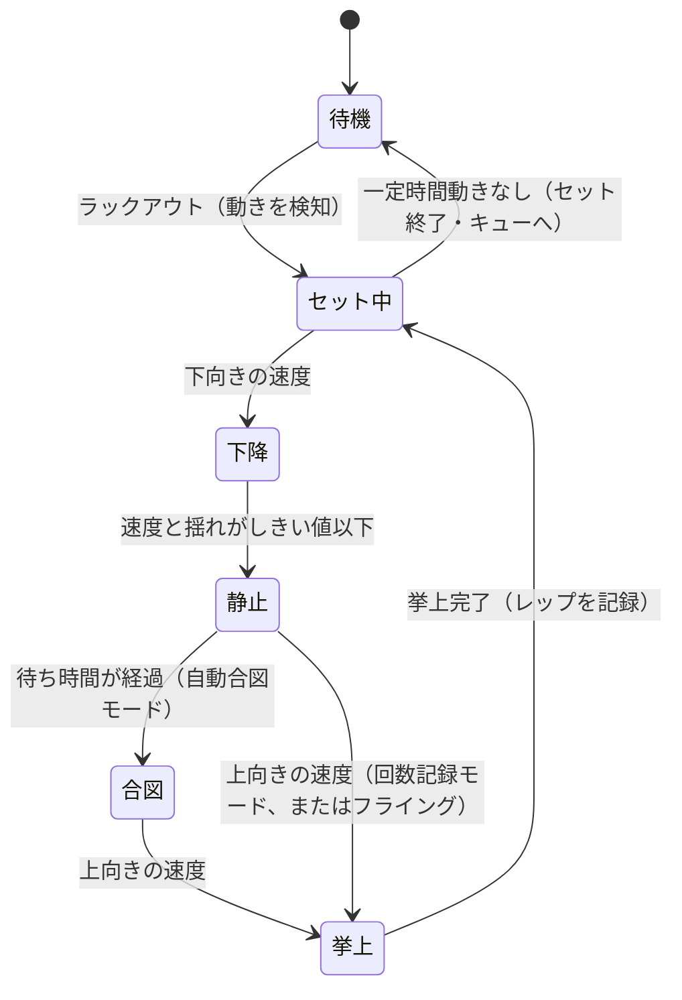
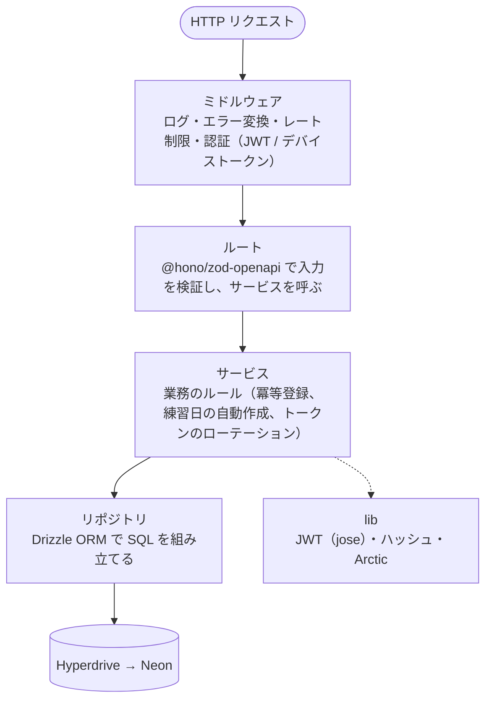
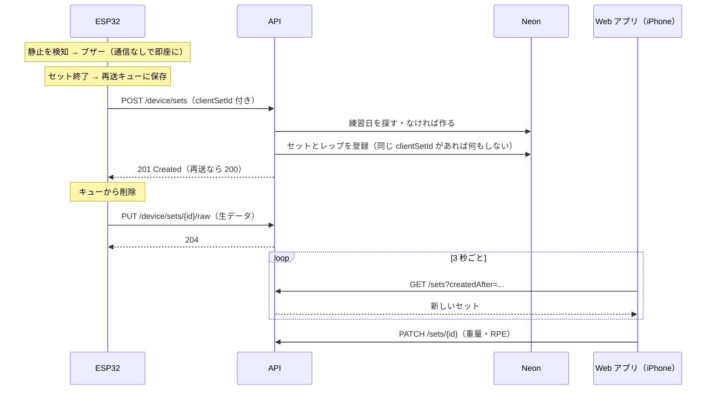
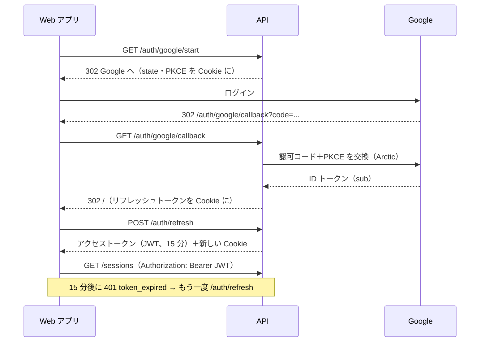

# ベンチプレス静止感知アプリ アーキテクチャ設計

Nov 15, 2026 · @Kato Hayate

## 1. 全体アーキテクチャ



システムは 3 つの場所に分かれる。部室の ESP32 は計測と合図を通信なしで行い、記録だけを iPhone のテザリング経由で送る。Cloudflare の Worker 1 つが画面の配信と API を兼ね（同じオリジンにすることで Cookie と CORS の問題を避ける）、データは Hyperdrive を通して Neon に保存する。本人確認だけは Google に任せる。

| 部品 | 責任 | 持たないもの |
| --- | --- | --- |
| ESP32 | 計測、判定、合図、記録の送信と再送 | 画面（設定ページを除く）、ユーザーの認証情報 |
| Web アプリ | 設定の変更、記録の表示・編集・削除、ペアリングの許可 | データそのもの（すべて API から取る） |
| Hono API | 認証、入力の検証、業務のルール、DB への読み書き | 重い計算（速度の計算は ESP32 が済ませる） |
| Neon | すべての記録とトークンのハッシュ | トークンそのもの |

## 2. ファームウェアの内部構成

ESP32 の 2 つの CPU コアを「計測（コア 1）」と「通信（コア 0）」に分け、通信が遅れても判定と合図が止まらないようにする（NFR-01・02）。タスク同士は FreeRTOS のキュー（受け渡し用の箱）だけでやり取りし、同じ変数を直接取り合わない。



| タスク | コア | 役割 | 注意点 |
| --- | --- | --- | --- |
| SensorTask | 1 | 10ms ごとに加速度・角速度を読み、キューに渡す | タイマーで周期を守る。他の処理を一切しない |
| DetectionTask | 1 | 姿勢推定、速度の積分、状態遷移（下の図）、レップの記録 | 判定ロジックはハードに依存しない C++ に切り出し、PC 上でテストする |
| SignalTask | 1 | Press 合図でブザーと LED を鳴らす。未送信や未接続も LED で知らせる | 合図は通信を待たずに即座に出す |
| StorageTask | 0 | 終わったセットを受け取り、すぐ LittleFS に保存する | NetTask より優先度を高くし、通信中（最長 25 秒ほど）でも保存を待たせない |
| NetTask | 0 | テザリングへの接続、設定の取得（5 秒おき）、セットの開始・終了の指示の取得（5 秒おき、ADR-0011）、再送キュー（LittleFS）の送信、NTP | セット中は設定の問い合わせを止める（指示の問い合わせは続ける）。失敗時は間隔を延ばして再試行 |

### 判定の状態遷移（ADR-003 のたたき台）



自動合図モードで「静止 → 挙上」に進んだ場合（合図より先に挙げた）は、そのレップをフライング（`isPremature = true`）として記録する。しきい値は部室で取った生データで決める。セットの区切り方は ADR-0011 のとおり。サーバにつながっているあいだは、Web アプリで開始・終了を押した時刻で区切る。指示は最大 5 秒遅れて届くので、セットの外で終わったレップを 30 秒ぶんためておき、押した時刻より後に下降を始めたレップをさかのぼって入れる。押した時刻はサーバの時刻で届くので、応答の `serverTime` との差でこの機器の uptime に直す（NTP に頼らない）。記録中に 3 分動きがなければ自分で終え、`PUT /device/recording` で伝える。記録中は LED をゆっくり点滅させる。指示を 15 秒取れないあいだは、これまでどおり動きで区切る（フェーズが変わらないまま 15 秒で終了。ステップ4で仮決め、生データで見直す）。

フラッシュへの書き込みは時間がかかるので、計測側は終わったセットを FreeRTOS のキューで StorageTask に渡すだけにする。StorageTask がすぐ LittleFS に保存し（送る前に必ず保存：FR-D11）、NetTask は LittleFS から古い順に読んで送り、受け取りを確認したら消す。保存を NetTask と分けたのは、NetTask が HTTPS の通信で止まっている間に終わったセットが RAM の中だけにあり、電源を切ると消えてしまうため。LittleFS へのアクセスは StorageTask と NetTask で取り合うので、ミューテックスで排他する。

### フラッシュの区切り方（パーティション）

ESP32-WROOM-32E のフラッシュは 4MB（実機で確認）。無線でのファーム更新（OTA）はスコープ外なので、プログラムの書き込み先を 1 つにした `no_ota.csv`（Arduino の既定の表のひとつ）を使う（2026-11-21 変更。それまでの `default.csv` ではプログラムの領域の 96% を使っていた）。

| 領域 | 位置 | 大きさ | 中身 |
| --- | --- | --- | --- |
| nvs | 0x9000 | 20KB | デバイストークン（Preferences） |
| otadata | 0xE000 | 8KB | 使わない（表の決まりで残る） |
| app0 | 0x10000 | 2MB | プログラム（変更時点で 60% を使用） |
| spiffs | 0x210000 | 約 1.9MB | LittleFS：未送信のセット・最後に取得した設定 |
| coredump | 0x3F0000 | 64KB | 異常終了したときの記録 |

`huge_app.csv`（プログラム 3MB・LittleFS 約 0.9MB）も候補だったが、この先の機能（ボタンでの開始・終了、設定モード、LED）にはプログラム 2MB で足り、LittleFS には生データ（FR-D12、1 セット最大 256KB）を送れないあいだためる余地を残したいので `no_ota.csv` にした。

**区切り方を変えて書き込むときの注意**：LittleFS の位置が変わるので、中身（未送信のセット・設定）は消える（次の起動でフォーマットし直す）。書き込む前に、テザリングにつないでシリアルの `# NET ... pending=0` を確かめ、未送信の記録を送り切っておく。NVS の位置は変わらないので、デバイストークンは残り、ペアリングし直す必要はない。設定は起動後に API から取り直す。

## 3. API サーバの内部構成

リクエストは上から下へ一方向に流れ、各層は自分のすぐ下の層だけを呼ぶ。「HTTP のこと」「業務のルール」「DB のこと」を層ごとに分けることで、たとえば冪等なセット登録のルールを DB なしでテストできる。



### フォルダ構成（apps/api/src）

```
src/
├─ index.ts            アプリの組み立て（ミドルウェアとルートを登録、/api 以外は画面を返す）
├─ middleware/
│  ├─ auth-user.ts      アクセストークン（JWT）を検証して userId を渡す
│  ├─ auth-device.ts    デバイストークンをハッシュして DB と照合する
│  └─ error.ts          例外を problem+json に変換する
├─ routes/             auth.ts / pairing.ts / device.ts / sessions.ts / sets.ts / devices.ts
├─ services/           auth.ts / pairing.ts / sets.ts / settings.ts（業務のルール）
├─ repositories/       users.ts / tokens.ts / devices.ts / sets.ts など（DB アクセス）
├─ db/
│  ├─ schema.ts         Drizzle のテーブル定義（データ設計の 11 テーブル）
│  └─ client.ts         Hyperdrive 経由の接続
└─ lib/                jwt.ts / hash.ts / oauth.ts / user-code.ts
```

**共有するもの**：リクエストとレスポンスの形（Zod スキーマ）は `packages/shared` に置き、API と Web アプリの両方から使う。片方だけ変えて食い違うと、型チェック（CI）で気づける。

## 4. 主な処理の流れ

### セットの登録から画面表示まで

合図はデバイスの中で完結し、通信はセットが終わってから行う。送信が失敗しても記録はキューに残り、再送で二重登録にはならない。



セットとレップの登録は 1 つのトランザクションで行い、「セットだけ入ってレップがない」状態を作らない。

### ログインとトークンの更新



## 5. 実行環境とデプロイ

環境は「手元（開発）」と「本番」の 2 つだけ。本番へのデプロイは、CI が通った main ブランチから手動で行う（自分しか使わないため、自動デプロイは後回し）。

| 項目 | 手元（Mac Studio） | 本番 |
| --- | --- | --- |
| API・Web アプリ | `wrangler dev`（Workers を手元で再現）、`vite dev` | Cloudflare Workers（`wrangler deploy`） |
| DB | Neon の開発用ブランチ `dev`（本番 DB のコピー）。`pnpm dev` が `.dev.vars` の `DATABASE_URL` を Hyperdrive の代わりに渡す | Neon の `production` ブランチ（Hyperdrive 経由、キャッシュ無効） |
| マイグレーション | `drizzle-kit migrate` を開発ブランチへ | デプロイ前に同じコマンドを本番へ（接続文字列はその場で入力し、ファイルに保存しない） |
| Google OAuth | 開発用の戻り先 URL（localhost）を登録 | 本番の戻り先 URL を登録 |
| ESP32 | USB で書き込み、接続先を手元の API に切り替えられるようにする | 本番の API |

### 秘密情報の置き場

| 秘密情報 | 本番の置き場 | 手元の置き場 |
| --- | --- | --- |
| JWT 署名用の秘密鍵（ES256） | Workers の Secrets（`wrangler secret put`） | `.dev.vars`（Git に入れない） |
| Google のクライアント ID とシークレット | Workers の Secrets | `.dev.vars` |
| Neon の接続文字列 | Hyperdrive の設定の中（コードには書かない） | `.dev.vars` |
| テザリングの SSID・パスワード | ESP32 のフラッシュ（設定ページで入力） | 開発初期は `secrets.h`（Git に入れない） |
| デバイストークン | ESP32 のフラッシュ（ペアリングで取得） | 同じ |

**公開リポジトリにする前に**：`.dev.vars` と `secrets.h` を `.gitignore` に入れ、サンプル（`.dev.vars.example`、`secrets.example.h`）だけをコミットする。
