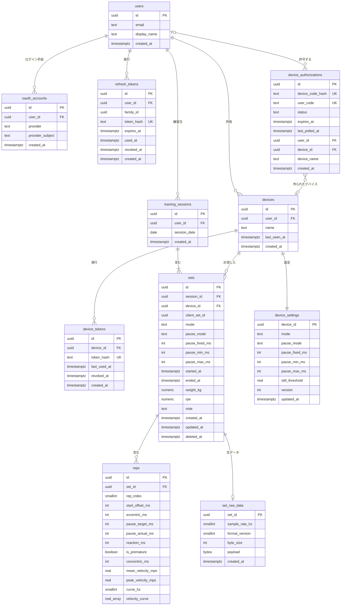

# ベンチプレス静止感知アプリ データ設計（ER図）

Nov 15, 2026 · @Kato Hayate

## 1. ER図

テーブルは 11 個。認証まわり（6 個）、デバイスの設定（1 個）、記録まわり（4 個）に分かれ、どちらも users にぶら下がる。記録は「練習日（training\_sessions）→ セット → レップ」の 3 段で、重い生データだけ別テーブルに分けている。

記号の読み方：`||--o{` は「1 対 0 個以上」、`||--|{` は「1 対 1 個以上」、`||--o|` は「1 対 0 か 1 個」。PK は主キー（行を一意に決める列）、FK は外部キー（別の表の行を指す列）、UK は重複を許さない列。`real_array` は PostgreSQL では `real[]`（小数の配列）。

## 2. テーブル定義：認証まわり

ID はすべて UUID（`gen_random_uuid()` で自動生成）、日時はすべてタイムゾーン付き（timestamptz）。以下では各テーブルに共通の `id` と `created_at` を省略する。

### users（ユーザー）

| 列 | 型 | 制約 | 説明 |
| --- | --- | --- | --- |
| email | text | NOT NULL | Google から取得したメールアドレス。表示用で、本人確認には使わない |
| display\_name | text |  | 画面に出す名前 |

### oauth\_accounts（Google アカウントとの紐づけ）

| 列 | 型 | 制約 | 説明 |
| --- | --- | --- | --- |
| user\_id | uuid | FK → users、NOT NULL | どのユーザーのアカウントか |
| provider | text | NOT NULL | `google`（将来 GitHub などを足す余地を残す） |
| provider\_subject | text | NOT NULL、(provider, provider\_subject) で UNIQUE | Google の ID トークンに入っているユーザー固有の ID（sub）。**本人の特定にはメールではなくこれを使う** |

### refresh\_tokens（リフレッシュトークン）

| 列 | 型 | 制約 | 説明 |
| --- | --- | --- | --- |
| user\_id | uuid | FK → users、NOT NULL | 誰のトークンか |
| family\_id | uuid | NOT NULL、INDEX | 同じログインから交換され続けたトークンの系統。盗難を検知したら系統ごと失効させる |
| token\_hash | text | NOT NULL、UNIQUE | トークンの SHA-256 ハッシュ。トークンそのものは保存しない |
| expires\_at | timestamptz | NOT NULL | 有効期限（発行から 30 日） |
| used\_at | timestamptz |  | 交換に使われた日時。**ここに値があるトークンが再び来たら盗難とみなす** |
| revoked\_at | timestamptz |  | ログアウトや盗難検知で失効させた日時 |

### devices（デバイス）

| 列 | 型 | 制約 | 説明 |
| --- | --- | --- | --- |
| user\_id | uuid | FK → users、NOT NULL | 持ち主 |
| name | text | NOT NULL | 例：「部室のベンチ」 |
| last\_seen\_at | timestamptz |  | 最後に記録を送ってきた日時。送り忘れや故障の確認に使う |

### device\_tokens（デバイストークン）

| 列 | 型 | 制約 | 説明 |
| --- | --- | --- | --- |
| device\_id | uuid | FK → devices、NOT NULL | どのデバイスのトークンか |
| token\_hash | text | NOT NULL、UNIQUE | トークンの SHA-256 ハッシュ |
| last\_used\_at | timestamptz |  | 最後に使われた日時 |
| revoked\_at | timestamptz |  | 失効させた日時。値があれば使えない |

デバイスとトークンを分けているのは、紛失や再ペアリングでトークンだけを作り直しても、そのデバイスの過去の記録とのつながりを残すため。

### device\_authorizations（ペアリングの途中状態）

RFC 8628 方式のペアリングで、コードを発行してからトークンを渡すまでの状態を持つ。期限は 10 分で、古いものは定期的に掃除する。

| 列 | 型 | 制約 | 説明 |
| --- | --- | --- | --- |
| device\_code\_hash | text | NOT NULL、UNIQUE | ESP32 だけが知る合言葉（deviceCode）の SHA-256 ハッシュ |
| user\_code | text | NOT NULL、UNIQUE | 人が入力する 8 文字のコード |
| status | text | NOT NULL、`pending` / `approved` / `denied` / `consumed` | 許可待ち、許可済み、拒否、トークン受け取り済み |
| expires\_at | timestamptz | NOT NULL | 発行から 10 分 |
| last\_polled\_at | timestamptz |  | ESP32 が最後に問い合わせた日時。問い合わせが速すぎるとき（slow\_down）の判定に使う |
| user\_id | uuid | FK → users | 許可したユーザー（許可されるまで空） |
| device\_id | uuid | FK → devices | 許可時に作られたデバイス |
| device\_name | text |  | Web アプリで入力されたデバイス名 |

### device\_settings（デバイスの設定）

Web アプリで変更し、ESP32 が数秒おきに取りに来る設定。1 デバイスに 1 行。

| 列 | 型 | 制約 | 説明 |
| --- | --- | --- | --- |
| device\_id | uuid | PK かつ FK → devices | どのデバイスの設定か |
| mode | text | NOT NULL、`auto_signal` か `count_only` | 自動合図モードか回数記録モードか |
| pause\_mode | text | `fixed` か `random` | 待ち時間の決め方 |
| pause\_fixed\_ms | int | pause\_mode = fixed のとき必須 | 固定の待ち時間 |
| pause\_min\_ms / pause\_max\_ms | int | pause\_mode = random のとき必須、min ≦ max | ランダムの範囲 |
| still\_threshold | real |  | 静止とみなす揺れの大きさ。空ならファームの既定値 |
| version | int | NOT NULL、更新のたびに +1 | ESP32 が「手元の設定が最新か」を軽く確かめるための番号 |
| updated\_at | timestamptz | NOT NULL | 最後に変更した日時 |

## 3. テーブル定義：記録まわり

### training\_sessions（練習日）

| 列 | 型 | 制約 | 説明 |
| --- | --- | --- | --- |
| user\_id | uuid | FK → users、NOT NULL | 誰の練習か |
| session\_date | date | NOT NULL、(user\_id, session\_date) で UNIQUE | 練習日（日本時間）。**同じ日のセットは自動で 1 つにまとまる** |

### sets（セット）

| 列 | 型 | 制約 | 説明 |
| --- | --- | --- | --- |
| session\_id | uuid | FK → training\_sessions、NOT NULL | どの練習日のセットか |
| device\_id | uuid | FK → devices、NOT NULL | どのデバイスで計測したか |
| client\_set\_id | uuid | NOT NULL、(device\_id, client\_set\_id) で UNIQUE | デバイスが作る ID（冪等キー）。**同じセットが二重に届いても 1 行にしかならない** |
| mode | text | NOT NULL、`auto_signal` か `count_only` | 自動合図モードか回数記録モードか |
| pause\_mode | text | `fixed` か `random`。自動合図モードのときだけ入る | 待ち時間の設定方法 |
| pause\_fixed\_ms | int | pause\_mode = fixed のとき必須 | 固定の待ち時間（ミリ秒） |
| pause\_min\_ms / pause\_max\_ms | int | pause\_mode = random のとき必須、min ≦ max | ランダムの範囲 |
| started\_at / ended\_at | timestamptz | NOT NULL、started\_at ≦ ended\_at | セットの開始・終了時刻 |
| weight\_kg | numeric(5,1) | 0 以上 | 重量（kg、0.5kg 刻みも入るように小数 1 桁）。未入力可 |
| rpe | numeric(3,1) | 1〜10 | 主観的なきつさ。未入力可 |
| note | text |  | メモ |
| updated\_at | timestamptz | NOT NULL | 重量やメモを後から編集した日時 |
| deleted\_at | timestamptz | 空なら有効 | 削除した日時。値があれば一覧から除外し、レップと生データは消す。行を残すのは、同じ clientSetId が再送されても復活させないため |

### reps（レップ）

| 列 | 型 | 制約 | 説明 |
| --- | --- | --- | --- |
| set\_id | uuid | FK → sets、NOT NULL、セットを消すと一緒に消える | どのセットのレップか |
| rep\_index | smallint | NOT NULL、(set\_id, rep\_index) で UNIQUE | 何レップ目か（1 始まり） |
| start\_offset\_ms | int | NOT NULL | セット開始から何ミリ秒後に始まったか |
| eccentric\_ms | int |  | 下降にかかった時間 |
| pause\_target\_ms | int | 自動合図モードのみ | このレップで実際に使った待ち時間（ランダムならその回の値） |
| pause\_actual\_ms | int |  | 胸の上で実際に止まっていた時間 |
| reaction\_ms | int | 自動合図モードのみ | 合図から挙上開始までの時間。フライングのときは空 |
| is\_premature | boolean | NOT NULL、既定 false | 合図より前に挙げたか（フライング） |
| concentric\_ms | int |  | 挙上にかかった時間 |
| mean\_velocity\_mps | real |  | 挙上の平均速度（MCV、m/s） |
| peak\_velocity\_mps | real |  | 挙上の最大速度（PCV、m/s） |
| curve\_hz | smallint |  | 速度カーブのサンプル周波数 |
| velocity\_curve | real\[\] |  | 挙上中の速度の時系列（速度カーブ）。100Hz・1.5 秒で約 150 個の数値 |

### set\_raw\_data（センサーの生データ）

| 列 | 型 | 制約 | 説明 |
| --- | --- | --- | --- |
| set\_id | uuid | PK かつ FK → sets（1 セットに最大 1 つ） | どのセットの生データか |
| sample\_rate\_hz | smallint | NOT NULL | サンプリング周波数（例：100） |
| format\_version | smallint | NOT NULL | バイナリ形式の版。形式を変えても古いデータを読めるようにする |
| byte\_size | int | NOT NULL | payload の大きさ |
| payload | bytea | NOT NULL | 加速度 3 軸＋角速度 3 軸を 16 ビット整数で並べたバイナリ。30 秒で約 36KB |

## 4. 設計の判断と理由

| 判断 | 理由 |
| --- | --- |
| **練習日は API が自動で作る** | セットを受け取ったら、started\_at を日本時間に直した日付で training\_sessions を探し、なければ作る。デバイスや画面は練習日を意識しなくてよい |
| **セットにレップ数の列を持たない** | reps の行数と食い違うとどちらが正しいか分からなくなるため。一覧では reps を数えて出す（記録数が少ないので負荷は問題にならない） |
| **重複防止は DB の UNIQUE 制約で担保** | (device\_id, client\_set\_id) を UNIQUE にし、API は「すでにあれば何もしない」で書き込む。通信が途中で切れて再送しても二重にならない（FR-S04） |
| **自動合図モードだけの列は CHECK 制約で守る** | mode が count\_only なら待ち時間の列は空、auto\_signal なら必須、というルールを DB 側でも強制する。バグでおかしなデータが入るのを防ぐ |
| **ADR-009：生データは DB のバイナリ列に、別テーブルで保存** | 16 ビット整数のバイナリなら 1 セット約 36KB。週 20 セットで年約 37MB なので、Neon の 1GB に十分収まる。JSON より小さく、Workers で解析しなくてよいので CPU 10ms にも収まる。別テーブルにするのは、一覧画面で重いデータを読み込まないため。容量が足りなくなったら Cloudflare R2 に移す |
| **速度カーブは配列列でレップに持たせる** | 1 点 1 行にすると行数が爆発する（1 セットで数百行）。速度カーブは「レップごとに丸ごと表示する」使い方しかしないので、配列で十分 |
| **重量は numeric、速度は real** | 重量は表示も集計もぴったり合ってほしいので、誤差の出ない numeric。速度はそもそもセンサーの誤差が大きいので、軽い real（浮動小数点）で十分 |
| **トークンは削除せず失効日時を入れる** | いつ失効したかを履歴として残す。特にリフレッシュトークンは、使用済みのものが残っていないと盗難を検知できない。期限切れのものは定期的に掃除する |
| **本人の特定は Google の sub で行う** | メールアドレスは変更されることがあるため。Google が保証する変わらない ID（sub）で紐づける |
| 設定はセットにコピーして残す | device\_settings は「今の設定」、sets の mode や pause\_\* は「そのセットで使った設定」。あとで設定を変えても、過去の記録がどの条件で取られたか分かるようにする |

## 5. 未決事項

- [x] **日付の区切り時刻**：0 時をまたいで練習することはないため、日本時間の暦日で区切る（決定）
- [ ] **ペアリング用のテーブル**：ADR-006 で方式を決めたら、ペアリングコードを一時的に保存するテーブルを足す
- [ ] **生データのバイナリ形式の詳細**：軸の並び順、単位、エンディアンを、ファームで生データを取るときに決める
