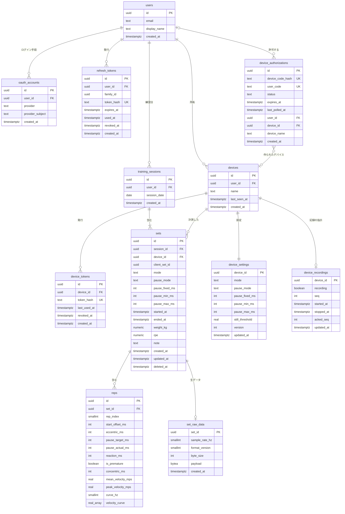

# ER 図

テーブルは 12 個。認証まわり（6 個）、デバイスの設定と記録の指示（2 個）、記録まわり（4 個）。列の詳しい説明はデータ設計のドキュメントを参照。

`real_array` は PostgreSQL では `real[]`。主な制約：

- `oauth_accounts`：`(provider, provider_subject)` で UNIQUE
- `training_sessions`：`(user_id, session_date)` で UNIQUE（同じ日のセットは 1 つの練習日にまとまる）
- `sets`：`(device_id, client_set_id)` で UNIQUE（冪等キー。再送されても 1 行のまま）
- `reps`：`(set_id, rep_index)` で UNIQUE
