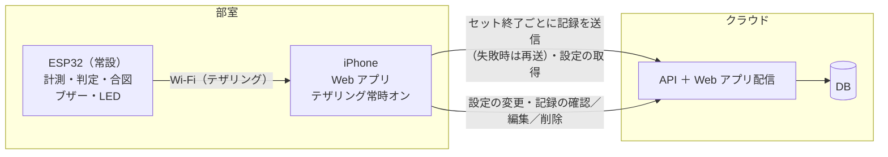

# ベンチプレス静止感知・自動記録アプリ 要件定義書

Nov 13, 2026 · @Kato Hayate

## 1. 概要

ベンチプレスでバーが胸の上で静止したことをデバイスが検知して Press 合図を出し、セットの記録（レップ数・速度・静止時間）を手入力なしでサーバに残す。まずは個人利用で完結させ、認証・サーバ・データ設計を一から設計する学習兼ポートフォリオのプロジェクトとする。

- **目的1**：競技ルールに沿った「胸で止めてから合図で挙げる」練習を一人でもできるようにする
- **目的2**：速度ベースのトレーニング（VBT）に使える速度データを自動で蓄積する
- **目的3**：ユーザー認証・デバイス認証・オフライン同期を含むシステムを、ER図・API仕様・ADR・CI付きで設計・実装する
- **利用者**：開発者本人のみ（1ユーザー）。ただしデータモデルと認証は複数ユーザーに拡張できる形にする
- **既存プロジェクトとの関係**：v-lift-log とは別リポジトリ。ハードウェア（ESP32＋MPU-6050）は以前の審判合図デバイスのものを流用する

## 2. 用語定義

| 用語 | 意味 |
| --- | --- |
| 練習日（セッション） | 1 日分の練習。同じ日（日本時間）のセットを自動で 1 つにまとめる |
| セット | ラックアウトからラックまでの一連の動作。開始と終了はデバイスが自動で判定する |
| レップ | 下降（エキセントリック）→静止→挙上（コンセントリック）の1回 |
| 静止 | 胸の上でバーの速度・加速度がしきい値以下に収まっている状態 |
| 待ち時間 | 静止を検知してから Press 合図を出すまでの時間。固定値かランダム範囲で設定する |
| フライング | Press 合図より前に挙上を始めたこと（合図無視） |
| 自動合図モード | 静止を検知して Press 合図を出し、記録もするモード |
| 回数記録モード | 合図を出さず、レップ数と速度だけを記録するモード |
| 速度カーブ | 1レップ内のバー速度の時系列 |
| 速度分布 | セット内・セット間で比べた、レップごとの平均速度（MCV）と最大速度（PCV）の分布 |
| Web アプリ | スマホのブラウザで開く唯一の画面。設定の変更、記録の確認・編集・削除、デバイス管理を行う |
| テザリング | スマホの携帯回線を Wi-Fi でほかの機器に分ける機能。ESP32 はこれでインターネットにつながる |
| 設定モード | 初回やリセット時だけ、ESP32 が自分の Wi-Fi（AP）と小さな設定ページを出す状態。テザリングの SSID とパスワードの登録に使う |
| ペアリング | デバイスをユーザーのアカウントに紐づけ、デバイストークンを発行する手続き。ESP32 が表示したコードを Web アプリで入力して許可する（RFC 8628 方式） |
| 再送キュー | 送れなかった記録をデバイスにためておき、つながったら古い順に送る仕組み |
| AP（アクセスポイント） | ほかの機器が接続しに来る親機の役割。ESP32 は設定モードのときだけ AP になる |
| STA（ステーション） | 既存の Wi-Fi に接続しに行く子機の役割。普段の ESP32 は STA としてテザリングにつなぐ |

## 3. システム構成

練習中はスマホのテザリングを常にオンにし、部室に常設した ESP32 はそれを経由してインターネットにつながる。画面は Web アプリ 1 つだけで、モードや待ち時間の設定も記録の確認もここで行う。ESP32 はセットが終わるたびに記録を API に送り、送れなければためておいて再送する。合図はブザーと LED でデバイス自身が出す。

## 4. 機能要件

優先度は Must（MVPに必須）・Should（MVP後すぐ）・Could（余裕があれば）の3段階。

### 4.1 デバイス（計測・判定）

| ID | 要件 | 優先度 |
| --- | --- | --- |
| FR-D01 | MPU-6050 から加速度・角速度を一定周期（例：100Hz）で取得する | Must |
| FR-D02 | レップの下降・静止・挙上を判定し、レップ数を数える | Must |
| FR-D03 | セットの開始と終了を自動で判定する（例：一定時間動きがなければ終了） | Must |
| FR-D04 | 自動合図モードでは、静止が待ち時間続いたら Press 合図を出す | Must |
| FR-D05 | 待ち時間は「固定（例：1.0秒）」か「ランダム（例：0.5〜1.5秒）」を使う | Must |
| FR-D06 | 回数記録モードでは合図を出さず、レップ数と速度だけを記録する | Must |
| FR-D07 | レップごとの速度カーブ、平均速度（MCV）、最大速度（PCV）を算出する | Must |
| FR-D08 | 自動合図モードでは、使った待ち時間・実際の静止時間・合図から挙上開始までの反応時間・フライングの有無を記録する | Must |
| FR-D09 | 合図はブザーと LED で出す | Must |
| FR-D10 | モード・待ち時間などの設定は API から取得して使う。つながらないときは最後に取得した設定で動く | Must |
| FR-D11 | 送信が済むまでセットの記録をフラッシュ（LittleFS）に保存し、電源を切っても消えない | Must |
| FR-D12 | センサーの生データをセットごとに送る（あとで判定ロジックを再検証するため） | Should |
| FR-D13 | 静止判定のしきい値も設定で変えられる | Should |

### 4.2 初回設定（設定モード）

| ID | 要件 | 優先度 |
| --- | --- | --- |
| FR-C01 | 初回起動時と、ボタンの長押しで設定モードに入り、ESP32 が AP と設定ページを出す | Must |
| FR-C02 | 設定ページでテザリングの SSID とパスワードを登録できる | Must |
| FR-C03 | ペアリング中は、テザリング経由で http://bench.local（mDNS）にコードと Web アプリへの許可用リンクを表示する。部室で iPhone 1 台で完結する | Must |
| FR-C04 | 設定モードの AP はパスワードで保護する | Must |

### 4.3 通信（デバイス ↔ API）

| ID | 要件 | 優先度 |
| --- | --- | --- |
| FR-S01 | 普段は登録したテザリングに STA として接続する。ESP32 は 2.4GHz のみ対応 | Must |
| FR-S02 | セットが終わるたびに、記録を HTTPS で API に送る | Must |
| FR-S03 | 通信はデバイストークンで認証する | Must |
| FR-S04 | 各セットにデバイスが作る ID（冪等キー）を付け、同じセットを二重に送っても重複しない | Must |
| FR-S05 | 送れなかった記録は再送キューにため、つながったら古い順に送る | Must |
| FR-S06 | サーバが受け取りを確認した記録だけをデバイスから削除する | Must |
| FR-S07 | セット中でないとき、数秒おきに API から最新の設定を取得する | Must |
| FR-S08 | デバイスが時刻を NTP で合わせる。合わせる前の記録は起動からの経過時間で持ち、送信時に補正する | Should |
| FR-S09 | 未送信の記録があることや、テザリングにつながっていないことを LED で知らせる | Should |

### 4.4 認証・デバイス管理

| ID | 要件 | 優先度 |
| --- | --- | --- |
| FR-A01 | ユーザーは OAuth（Google）でログインする。サーバは自前のアクセストークン（JWT）とリフレッシュトークンを発行する | Must |
| FR-A02 | リフレッシュトークンはローテーションし、ログアウトで失効できる | Should |
| FR-A03 | ESP32 が表示したコードを Web アプリで入力して許可すると、デバイストークンが発行される（RFC 8628 方式） | Must |
| FR-A04 | デバイストークンを一覧・失効できる（部室に常設するため、盗難・紛失時の対策として必須） | Must |
| FR-A05 | デバイストークンの権限は「自分の記録の登録」と「自分の設定の取得」だけに限る | Must |

### 4.5 Web アプリ

| ID | 要件 | 優先度 |
| --- | --- | --- |
| FR-V01 | 練習日とセットの一覧を日付の新しい順に見られる | Must |
| FR-V02 | セットの詳細で、レップごとの速度カーブを見られる | Must |
| FR-V03 | セット内・セット間の速度分布（MCV / PCV）を見られる | Must |
| FR-V04 | 重量・RPE・メモを入力・編集できる（セット直後に入力する想定） | Must |
| FR-V05 | セットを削除できる（誤判定や試しのセットを消す） | Must |
| FR-V06 | デバイスの設定（モード・待ち時間・しきい値）を変更できる | Must |
| FR-V07 | 練習中は数秒おきに更新し、新しいセットが届いたら自動で表示する | Must |
| FR-V08 | 自動合図モードのセットで、静止時間・反応時間・フライングの有無を見られる | Should |
| FR-V09 | デバイスの最終通信日時を表示する | Should |
| FR-V10 | 重量と速度の関係（負荷-速度プロファイル）や推定 1RM を見られる | Could |

## 5. 非機能要件

| ID | 区分 | 要件 |
| --- | --- | --- |
| NFR-01 | 性能 | 静止条件を満たしてからブザーが鳴り LED が光るまで 50ms 以内を目安とする |
| NFR-02 | 性能 | 通信処理は計測・判定と別のタスクで行い、サンプリング周期と合図を乱さない |
| NFR-03 | 性能 | 電波があるとき、セット終了から Web アプリに表示されるまで 10 秒以内 |
| NFR-04 | 可用性 | 電波やテザリングが途切れても、計測・合図・記録はデバイス単体で続く（送信だけ後回しになる） |
| NFR-05 | 信頼性 | 送信が途中で失敗しても記録が欠けたり重複したりしない（冪等・確認後削除） |
| NFR-06 | 容量 | デバイスの再送キューに少なくとも 50 セット分をためられる。足りないときは生データから間引く |
| NFR-07 | セキュリティ | API との通信はすべて HTTPS。デバイスはサーバ証明書を検証する |
| NFR-08 | セキュリティ | デバイスに置く秘密情報は、テザリングの SSID・パスワードとデバイストークンだけにする。大学アカウント（eduroam）の認証情報は保存しない |
| NFR-09 | セキュリティ | デバイストークンは最小権限で、サーバ側にはハッシュだけを保存する |
| NFR-10 | セキュリティ | 設定モードの AP は WPA2 のパスワードを設定する |
| NFR-11 | 運用コスト | サーバと DB は無料枠で運用する（技術選定で月 0 円を確認済み） |
| NFR-12 | 保守性 | API は OpenAPI で仕様を書き、設計の判断は ADR に残す |
| NFR-13 | 品質 | CI で lint・型チェック・テストを全 PR で回す。静止判定ロジックは記録済みの生データでテストできるようにする |

## 6. 制約・前提

- **ハードウェア**：既存の ESP32 と MPU-6050 にアクティブブザーを足して使う。部室に常設し、USB の AC アダプタで常時給電する。ESP32 に携帯回線（5G/LTE）はなく、通信手段は Wi-Fi と Bluetooth のみ
- **ネットワーク**：部室の Wi-Fi は eduroam のみ。デバイスは eduroam には接続せず、練習中はスマホのテザリング経由で通信する。部室でスマホの電波が入ることを前提とする
- **テザリング**：練習中はテザリングをオンにしておく（スマホのバッテリーを使う）。ESP32 は 2.4GHz のみ対応なので、iPhone 12 以降は「互換性を優先」をオンにする。スマホは iPhone を前提とする（ペアリングで mDNS の bench.local を使うため）
- **画面**：画面は Web アプリ 1 つ。ESP32 は設定モードの設定ページを除き、画面を配信しない。そのため合図はデバイスのブザーと LED で出す（クラウド経由でスマホから鳴らすと遅れるため）
- **処理の分離**：ESP32 は計測と通信を同時に行うため、通信が判定を止めないようタスクを分ける（FreeRTOS）
- **開発体制**：一人で開発。最初の動くものは 3 日で作る
- **技術選定**：「技術選定（ADR）」ドキュメントで決定済み（Hono on Cloudflare Workers、Neon、Vite＋React、Arctic＋自前 JWT）

## 7. スコープ外

- 他の部員との記録共有、コーチなどのロールと権限管理
- Start 合図と Rack 合図（Press 合図のみ対象）
- スクワット・デッドリフトなどベンチプレス以外の種目
- ネイティブアプリ（iOS / Android）
- デバイスのファームウェアを無線で更新する機能（OTA）
- レップごとのリアルタイム表示（表示はセット単位）
- スマホから合図音を鳴らすこと

## 8. MVP（3日）の範囲

MVP のゴールは「部室で自動合図付きのセットを行い、セット直後にその記録が Web アプリで見られる」こと。対象は 4 章の Must 要件。

1. **1日目：デバイス**
   - ADR-001（通信経路）を書く
   - ファームウェア：サンプリング、セットとレップの判定、静止判定、ブザーと LED の Press 合図
   - テザリングの SSID はいったんファームに直接書く（設定モードは後回し可）
2. **2日目：サーバ**
   - API 仕様（OpenAPI）を書く
   - DB スキーマとマイグレーション
   - API：Google OAuth ログイン、JWT 発行、デバイスのペアリング、セットの登録（冪等）・一覧・編集・削除、設定の取得・更新
3. **3日目：つなぎ込み**
   - ファームウェア：HTTPS での送信、再送キュー、設定の取得
   - Web アプリ：ログイン、セット一覧、速度カーブ、速度分布、重量入力、設定画面
   - CI：lint・型チェック・テスト

3 日で終わらない場合は、設定モードの設定ページ（FR-C01〜C04。その間は SSID をファームに直書きし、ペアリングコードはシリアル出力で確認）、生データの送信（FR-D12）、しきい値の設定（FR-D13）を後回しにする。

## 9. 未決事項と ADR 候補

| ADR | 決めること | 状態 |
| --- | --- | --- |
| ADR-001 | デバイスからサーバへの記録の経路 | 決定：練習中は常時テザリング。セットごとに即時送信し、失敗したら再送キュー。画面は Web アプリ 1 つ |
| ADR-002 | 静止判定をどこで行うか | 決定：デバイス側（合図の遅延を最小にするため） |
| ADR-003 | セット・レップ・静止の判定と速度推定のアルゴリズム | 未定。しきい値方式から始め、生データで検証する |
| ADR-004 | API サーバの言語とフレームワーク | 決定：Hono（TypeScript） |
| ADR-005 | ユーザー認証の方式 | 決定：Google OAuth（Arctic）＋自前 JWT＋リフレッシュトークンのローテーション |
| ADR-006 | デバイスのペアリング方式 | 決定：OAuth Device Authorization Grant（RFC 8628）方式。コードはテザリング経由で http://bench.local に表示（iPhone 前提） |
| ADR-007 | ホスティング先 | 決定：Cloudflare Workers（API と Web アプリ）＋Neon（PostgreSQL） |
| ADR-008 | Web アプリのフレームワーク | 決定：Vite＋React（SPA） |
| ADR-009 | 生データの保存方法 | 決定：DB のバイナリ列に別テーブルで保存 |

- [x] 重量の単位：kg のみ
- [x] 練習日の区切り：同じ日（日本時間の暦日）のセットを自動でまとめる
